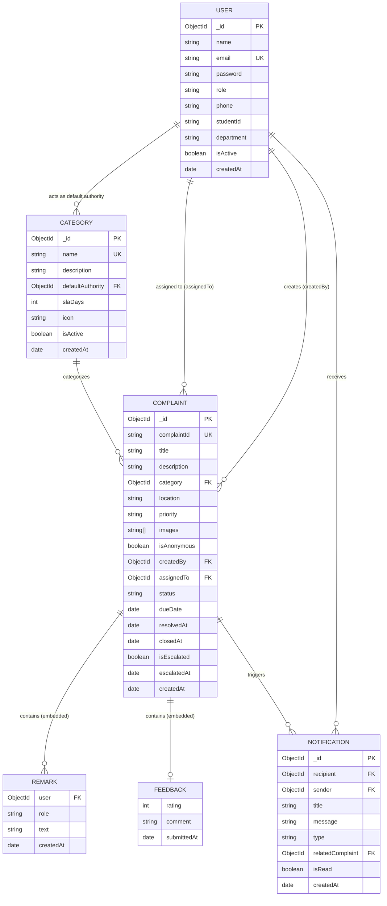

# System Architecture & Technical Design Document
## CampusVoice - College Complaint Management System

**Document Version:** 2.0  
**Status:** Approved for Implementation  
**Project Type:** Final Year Major Project  
**Target Architecture:** Multi-Tier Distributed Architecture (Flutter Mobile Client + Node.js REST API + MongoDB Atlas + Cloudinary CDN + Scheduled Cron Daemon)  
**Author:** Final Year Engineering Candidate  

---

## 1. Architectural Overview & System Topology

The **CampusVoice** platform implements a distributed, three-tier client-server architectural pattern designed for high availability, fault tolerance, strict security boundaries, and responsive mobile interactions.

### 1.1 High-Level Component Topology

```
+-----------------------------------------------------------------------------------+
|                                  CLIENT TIER                                      |
|                                                                                   |
|   +---------------------------------------------------------------------------+   |
|   |                  Flutter Mobile Application (Android APK)                 |   |
|   |  - Presentation Layer: Material 3 Reactive Widgets                        |   |
|   |  - State Management: Provider (ChangeNotifier) Pattern                    |   |
|   |  - Network Layer: Dio HTTP Client + JWT Request Interceptor               |   |
|   |  - Secure Storage: flutter_secure_storage (Android Encrypted Keystore)    |   |
|   |  - Media Processing: Image Picker + Client-Side Downsampling              |   |
|   +---------------------------------------------------------------------------+   |
+------------------------------------------+----------------------------------------+
                                           |
                                           | HTTPS / TLS 1.3 (JSON + Multipart)
                                           | Header: Authorization: Bearer <JWT>
                                           v
+-----------------------------------------------------------------------------------+
|                              APPLICATION SERVER TIER                              |
|                                                                                   |
|   +---------------------------------------------------------------------------+   |
|   |                     Node.js & Express RESTful API Server                  |   |
|   |                                                                           |   |
|   |  [Security Perimeter]                                                     |   |
|   |  - Helmet (HTTP Header Protection)   - CORS Origin Whitelist              |   |
|   |  - Express-Rate-Limit (Brute-Force)  - Centralized Error Handler          |   |
|   |                                                                           |   |
|   |  [Middleware Pipeline]                                                    |   |
|   |  - JWT Authentication Middleware     - Role-Based Access Control (RBAC)   |   |
|   |  - Multer Memory Storage Buffer      - Express-Validator Sanitizer        |   |
|   |                                                                           |   |
|   |  [Controllers & Domain Services]                                          |   |
|   |  - Auth & Profile Controller         - Category Management Controller     |   |
|   |  - Complaint State Machine Engine    - Analytics Aggregation Engine       |   |
|   |  - Whistleblower Sanitizer Service   - In-App Notification Dispatcher     |   |
|   |                                                                           |   |
|   |  [Background Scheduler Daemon]                                            |   |
|   |  - Node-Cron SLA Escalation Engine (Evaluates overdue tickets daily)      |   |
|   +-------------------+-----------------------------------+-------------------+   |
+-----------------------|-----------------------------------|-----------------------+
                        |                                   |
                        | Mongoose Connection Pool          | Static Media Hosting Stream
                        | (SCRAM-SHA-256 / Port 27017)      | (Nginx Volume / Port 8080)
                        v                                   v
+-----------------------------------+   +-------------------------------------------+
|         PERSISTENCE TIER          |   |            MEDIA STORAGE TIER             |
|                                   |   |                                           |
|  +-----------------------------+  |   |  +-------------------------------------+  |
|  |   Docker MongoDB (v7.0)     |  |   |  |   Docker Media Server (Nginx)       |  |
|  | - users collection          |  |   |  | - Raw & Compressed Evidence Photos  |  |
|  | - categories collection     |  |   |  | - Dedicated persistent volume       |  |
|  | - complaints collection     |  |   |  | - High-throughput HTTP URL delivery |  |
|  | - notifications collection  |  |   |  | - Web management via Mongo Express  |  |
|  | - Indexed B-Trees on volume |  |   |  +-------------------------------------+  |
|  +-----------------------------+  |   +-------------------------------------------+
|  +-----------------------------+  |
|  |  Mongo Express UI (8081)    |  |
|  +-----------------------------+  |
+-----------------------------------+
```

---

## 2. Technology Stack & Architectural Trade-off Analysis

| Layer | Selected Technology | Evaluated Alternatives | Rationale & Academic Justification |
|---|---|---|---|
| **Mobile Client** | **Flutter / Dart** | React Native, Native Kotlin/Java | *Flutter* compiles directly to native ARM machine code without a JavaScript bridge (unlike React Native), ensuring 60fps animations. Flutter's widget tree guarantees identical rendering across heterogeneous Android versions (Android 8 through 14+), eliminating OEM layout fragmentation. |
| **Client State** | **Provider (`ChangeNotifier`)** | Riverpod, BLoC, Redux | *Provider* is Google's officially recommended pragmatic state management pattern for medium-scale apps. It enforces unidirectional data flow with minimal boilerplate compared to BLoC's complex event/state streams, fitting perfectly within the 25-day delivery roadmap. |
| **Server Framework** | **Node.js + Express.js** | Spring Boot, Django, FastAPI | *Node.js* utilizes an asynchronous, non-blocking single-threaded event loop that excels at I/O-heavy workloads (handling concurrent image uploads and JSON REST requests). Express provides lightweight modular routing, native JSON handling, and seamless NPM middleware integration. |
| **Primary Database** | **MongoDB Container (v7.0) + Mongoose** | PostgreSQL, MySQL, Cloud Atlas | *MongoDB* is a document-oriented NoSQL database. Grievance records are inherently hierarchical and non-uniform: varying photo arrays, chronological embedded remarks, polymorphic feedback, and dynamic category assignments. Storing these as rich BSON documents avoids expensive multi-table relational joins, allowing $O(1)$ single-query document retrieval. Containerization via Docker provides reproducible local execution with zero cloud dependency. |
| **Asset Storage** | **Docker Nginx Media Server / Local Storage** | Cloudinary CDN, AWS S3 | Dedicated containerized media server using Nginx (`campusvoice-media-server`) with isolated persistent volume. Eliminates external cloud quotas, API latency, and network dependencies during development and offline evaluation while serving evidence photos with HTTP caching and CORS headers. |
| **Task Scheduler** | **node-cron** | BullMQ + Redis, Celery | For a single-institution deployment, provisioning a separate Redis instance for message queues adds operational complexity. *node-cron* executes lightweight scheduled tasks in-process with minimal memory footprint. |

---

## 3. Comprehensive Data Models & Database Schemas

All data models are defined using **Mongoose ODM** schemas with strict validation constraints, default values, and optimized indexing.

### 3.1 Entity Relationship Diagram (ERD)



---

### 3.2 Schema Specifications

#### 3.2.1 User Schema (`models/User.js`)
```javascript
const userSchema = new mongoose.Schema({
  name: {
    type: String,
    required: [true, 'Name is required'],
    trim: true,
    minlength: 2,
    maxlength: 50
  },
  email: {
    type: String,
    required: [true, 'Email is required'],
    unique: true,
    lowercase: true,
    trim: true,
    match: [/^\w+([.-]?\w+)*@\w+([.-]?\w+)*(\.\w{2,3})+$/, 'Please provide a valid email']
  },
  password: {
    type: String,
    required: [true, 'Password is required'],
    minlength: 6,
    select: false // Excluded from query results by default for security
  },
  role: {
    type: String,
    enum: ['student', 'authority', 'admin'],
    default: 'student'
  },
  phone: {
    type: String,
    trim: true,
    match: [/^[0-9]{10}$/, 'Phone number must be exactly 10 digits']
  },
  studentId: {
    type: String,
    trim: true,
    sparse: true // Allows nulls while enforcing uniqueness if present
  },
  department: {
    type: String,
    trim: true
  },
  isActive: {
    type: Boolean,
    default: true
  }
}, { timestamps: true });

userSchema.index({ email: 1 });
userSchema.index({ role: 1 });
```

#### 3.2.2 Category Schema (`models/Category.js`)
```javascript
const categorySchema = new mongoose.Schema({
  name: {
    type: String,
    required: [true, 'Category name is required'],
    unique: true,
    trim: true,
    maxlength: 50
  },
  description: {
    type: String,
    trim: true,
    maxlength: 200
  },
  defaultAuthority: {
    type: mongoose.Schema.Types.ObjectId,
    ref: 'User',
    default: null
  },
  slaDays: {
    type: Number,
    required: [true, 'SLA turnaround days is required'],
    min: 1,
    max: 30,
    default: 3
  },
  icon: {
    type: String,
    default: 'help_outline'
  },
  isActive: {
    type: Boolean,
    default: true
  }
}, { timestamps: true });

categorySchema.index({ name: 1 });
categorySchema.index({ isActive: 1 });
```

#### 3.2.3 Complaint Schema (`models/Complaint.js`)
```javascript
const remarkSubSchema = new mongoose.Schema({
  user: {
    type: mongoose.Schema.Types.ObjectId,
    ref: 'User',
    required: true
  },
  role: {
    type: String,
    enum: ['student', 'authority', 'admin'],
    required: true
  },
  text: {
    type: String,
    required: true,
    trim: true,
    maxlength: 500
  },
  createdAt: {
    type: Date,
    default: Date.now
  }
});

const feedbackSubSchema = new mongoose.Schema({
  rating: {
    type: Number,
    required: true,
    min: 1,
    max: 5
  },
  comment: {
    type: String,
    trim: true,
    maxlength: 300
  },
  submittedAt: {
    type: Date,
    default: Date.now
  }
});

const complaintSchema = new mongoose.Schema({
  complaintId: {
    type: String,
    unique: true,
    required: true
  },
  title: {
    type: String,
    required: [true, 'Title is required'],
    trim: true,
    minlength: 5,
    maxlength: 100
  },
  description: {
    type: String,
    required: [true, 'Description is required'],
    trim: true,
    minlength: 20,
    maxlength: 1000
  },
  category: {
    type: mongoose.Schema.Types.ObjectId,
    ref: 'Category',
    required: [true, 'Category is required']
  },
  location: {
    type: String,
    required: [true, 'Location details are required'],
    trim: true,
    maxlength: 100
  },
  priority: {
    type: String,
    enum: ['Low', 'Medium', 'High', 'Urgent'],
    default: 'Medium'
  },
  images: [{
    type: String,
    trim: true
  }],
  isAnonymous: {
    type: Boolean,
    default: false
  },
  createdBy: {
    type: mongoose.Schema.Types.ObjectId,
    ref: 'User',
    required: true
  },
  assignedTo: {
    type: mongoose.Schema.Types.ObjectId,
    ref: 'User',
    default: null
  },
  status: {
    type: String,
    enum: ['Submitted', 'Assigned', 'In Progress', 'Resolved', 'Closed'],
    default: 'Submitted'
  },
  dueDate: {
    type: Date,
    default: null
  },
  resolvedAt: {
    type: Date,
    default: null
  },
  closedAt: {
    type: Date,
    default: null
  },
  isEscalated: {
    type: Boolean,
    default: false
  },
  escalatedAt: {
    type: Date,
    default: null
  },
  remarks: [remarkSubSchema],
  feedback: {
    type: feedbackSubSchema,
    default: null
  }
}, { timestamps: true });

// Compound Indexes for fast querying & dashboard analytics
complaintSchema.index({ complaintId: 1 });
complaintSchema.index({ createdBy: 1, status: 1 });
complaintSchema.index({ assignedTo: 1, status: 1 });
complaintSchema.index({ status: 1, dueDate: 1, isEscalated: 1 });
complaintSchema.index({ category: 1, createdAt: -1 });
```

#### 3.2.4 Notification Schema (`models/Notification.js`)
```javascript
const notificationSchema = new mongoose.Schema({
  recipient: {
    type: mongoose.Schema.Types.ObjectId,
    ref: 'User',
    required: true
  },
  sender: {
    type: mongoose.Schema.Types.ObjectId,
    ref: 'User',
    default: null
  },
  title: {
    type: String,
    required: true,
    trim: true
  },
  message: {
    type: String,
    required: true,
    trim: true
  },
  type: {
    type: String,
    enum: ['ASSIGNMENT', 'STATUS_CHANGE', 'REMARK', 'FEEDBACK', 'ESCALATION', 'SYSTEM'],
    default: 'STATUS_CHANGE'
  },
  relatedComplaint: {
    type: mongoose.Schema.Types.ObjectId,
    ref: 'Complaint',
    default: null
  },
  isRead: {
    type: Boolean,
    default: false
  }
}, { timestamps: true });

notificationSchema.index({ recipient: 1, isRead: 1, createdAt: -1 });
```

---

## 4. State Machine & Workflow Transition Engine

Complaints obey a deterministic **Finite State Machine (FSM)**. Transitions outside the verified matrix are rejected at the middleware/controller level.

```
       [ Student Submits Issue ]
                   |
                   v
            +--------------+
            |  SUBMITTED   |
            +-------+------+
                    |
                    | Auto-assigned or Admin Assigns
                    v
            +--------------+
      +---> |   ASSIGNED   |
      |     +-------+------+
      |             |
      |             | Authority Starts Work
      |             v
Reopened by   +--------------+
  Student     | IN PROGRESS  |
      |       +-------+------+
      |             |
      |             | Authority Fixes Issue
      |             v
      |     +--------------+
      +-----+   RESOLVED   |
            +-------+------+
                    |
                    | Student Rates & Reviews
                    v
            +--------------+
            |    CLOSED    |  (Terminal State)
            +--------------+
```

### 4.1 State Transition Validation Matrix

```javascript
// Enforcement logic implemented in backend controllers
const STATUS_TRANSITIONS = {
  'Submitted': ['Assigned'],
  'Assigned': ['In Progress', 'Assigned'], // Allows reassignment
  'In Progress': ['Resolved'],
  'Resolved': ['Closed', 'In Progress'],   // Reopening transitions to In Progress
  'Closed': []                             // Terminal state; no transitions permitted
};
```

| Current Status | Target Status | Authorized Roles | Mandatory Validations & Side-Effects |
|---|---|---|---|
| `Submitted` | `Assigned` | System, Admin | Requires valid `assignedTo`. Calculates `dueDate = Date.now() + (slaDays * 86400000)`. Sends `ASSIGNMENT` notification to authority. |
| `Assigned` | `In Progress` | Assigned Authority, Admin | Requires optional acknowledgement remark. Authority acknowledges active work. |
| `In Progress` | `Resolved` | Assigned Authority, Admin | Requires mandatory action remark detailing repair. Sets `resolvedAt = Date.now()`. Sends `STATUS_CHANGE` notification to student. |
| `Resolved` | `In Progress` | Complaint Owner (Student), Admin | Allowed only within 48h of resolution. Appends reason remark. Resets `resolvedAt = null`. Notifies authority. |
| `Resolved` | `Closed` | Complaint Owner (Student) | Requires star rating (1–5). Embeds feedback subdocument. Sets `closedAt = Date.now()`. Notifies authority. |

---

## 5. Mobile Application Architecture (Flutter)

The Flutter mobile application follows the **Model-View-ViewModel (MVVM)** architectural pattern powered by the **Provider** state management library.

```
+-------------------------------------------------------------------------+
|                           PRESENTATION LAYER                            |
|  - Screens (Auth, Student, Authority, Admin, Common)                    |
|  - Reusable Widgets (StatusChip, ComplaintCard, ImageUploadField)       |
|  - Modals & BottomSheets (FeedbackSheet, StatusUpdateDialog)            |
+------------------------------------+------------------------------------+
                                     |
                                     | Listens to state / Dispatches user actions
                                     v
+-------------------------------------------------------------------------+
|                        PROVIDER STATE LAYER                             |
|  - AuthProvider (Session state, User token, Role check, Auto-login)     |
|  - ComplaintProvider (Active list, Filters, Pagination, Form state)     |
|  - AdminProvider (User management, Category CRUD, Analytics data)       |
|  - NotificationProvider (Unread badge count, Inbox list)                |
+------------------------------------+------------------------------------+
                                     |
                                     | Calls domain business operations
                                     v
+-------------------------------------------------------------------------+
|                         SERVICE / DATA LAYER                            |
|  - AuthService (login, register, fetchProfile, logout)                  |
|  - ComplaintService (submitComplaint, fetchMy, updateStatus, feedback) |
|  - AdminService (getCategories, updateSla, getDashboardStats)           |
|  - NotificationService (getNotifications, markAsRead)                   |
+------------------------------------+------------------------------------+
                                     |
                                     | Executes HTTP & Local I/O
                                     v
+------------------------------------+------------------------------------+
|                         CORE INFRASTRUCTURE                             |
|  - ApiClient (Dio instance with Auth Interceptors & Retry Logic)        |
|  - SecureStorage (Wrapper around flutter_secure_storage / Keystore)     |
|  - AppConstants (API endpoints, Status colors, Enums)                   |
+-------------------------------------------------------------------------+
```

### 5.1 Flutter Directory Structure
```
lib/
├── main.dart                      # App entry, multi-provider setup, theme initialization
├── core/
│   ├── constants/
│   │   ├── api_endpoints.dart     # REST route strings
│   │   ├── app_colors.dart        # Material 3 color palette
│   │   └── app_enums.dart         # Status, Priority, Role enums
│   ├── network/
│   │   ├── api_client.dart        # Dio singleton with JWT interceptor
│   │   └── api_exceptions.dart    # Typed network error mappings
│   ├── storage/
│   │   └── secure_storage.dart    # Token & credential persistence
│   └── theme/
│       └── app_theme.dart         # Material 3 light/dark theme definitions
├── models/
│   ├── user_model.dart            # JSON deserialization for User
│   ├── complaint_model.dart       # Deep parsing for Complaint, Remark, Feedback
│   ├── category_model.dart        # Category definitions & SLA
│   ├── notification_model.dart    # Notification model
│   └── dashboard_stats_model.dart # Analytics DTO
├── services/
│   ├── auth_service.dart
│   ├── complaint_service.dart
│   ├── admin_service.dart
│   └── notification_service.dart
├── providers/
│   ├── auth_provider.dart
│   ├── complaint_provider.dart
│   ├── admin_provider.dart
│   └── notification_provider.dart
├── screens/
│   ├── auth/                      # Login, Register, Forgot Password
│   ├── student/                   # StudentHome, NewComplaint, MyComplaints
│   ├── authority/                 # AuthorityQueue, UpdateStatusSheet
│   ├── admin/                     # DashboardScreen, AllComplaints, Categories, Users
│   └── common/                    # ComplaintDetail, NotificationInbox, ProfileScreen, Splash
└── widgets/                       # Reusable UI widgets
```

### 5.2 Network & Authentication Interceptor (`ApiClient`)
The Dio HTTP client automatically injects the stored JWT into the `Authorization` header of every outbound request. If the server responds with `401 Unauthorized`, the interceptor clears local credentials and notifies `AuthProvider` to redirect the user to the login screen.

```dart
// Conceptual snippet: lib/core/network/api_client.dart
dio.interceptors.add(InterceptorsWrapper(
  onRequest: (options, handler) async {
    final token = await SecureStorage.getToken();
    if (token != null) {
      options.headers['Authorization'] = 'Bearer $token';
    }
    return handler.next(options);
  },
  onError: (DioException error, handler) async {
    if (error.response?.statusCode == 401) {
      await SecureStorage.clearToken();
      // Trigger navigation event to LoginScreen
    }
    return handler.next(error);
  },
));
```

---

## 6. Backend API Architecture & Security Pipeline

The backend server is structured into clean modular layers:

```
[ Incoming Request ]
         |
         v
[ Security: Helmet, CORS, Express-Rate-Limit ]
         |
         v
[ Routing Layer: routes/*.routes.js ]
         |
         v
[ Middleware: auth.js (JWT) -> role.js (RBAC) -> upload.js (Multer) -> validate.js ]
         |
         v
[ Controller Layer: controllers/*.controller.js ]
         |
         v
[ Data Access: models/*.js (Mongoose) ]
         |
         v
[ Standardized Response Envelope ]
```

### 6.1 Standardized API Response Envelopes

All REST endpoints adhere strictly to a deterministic response envelope:

#### Success Envelope (`200 OK`, `201 Created`):
```json
{
  "success": true,
  "message": "Complaint submitted successfully",
  "data": {
    "complaintId": "CMP-0042",
    "status": "Assigned",
    "title": "Air Conditioner Leaking"
  }
}
```

#### Error Envelope (`400`, `401`, `403`, `404`, `500`):
```json
{
  "success": false,
  "message": "Invalid status transition from Submitted to Resolved",
  "errors": [
    {
      "field": "status",
      "message": "Complaints must be Assigned before being Resolved"
    }
  ]
}
```

---

## 7. Whistleblower Anonymous Privacy Architecture

To guarantee the safety of students reporting sensitive incidents (e.g., hazing, ragging, sexual harassment, academic victimization), the system enforces privacy at the data presentation layer:

```
[ Database Storage ]
  Document contains: {
    complaintId: "CMP-0091",
    isAnonymous: true,
    createdBy: ObjectId("65dfa4b1..."), // Stored for data integrity & audit
    title: "Ragging in Hostel Room 104"
  }

                   |
                   v
[ Controller Logic: getComplaintById ]
  if (complaint.isAnonymous && req.user.role !== 'student') {
    complaint.createdBy = {
      _id: null,
      name: "Anonymous Student",
      email: null,
      phone: null,
      studentId: null
    };
  }

                   |
                   v
[ JSON Payload Sent to Authority / Admin ]
  "createdBy": {
    "name": "Anonymous Student",
    "email": null,
    "phone": null
  }
```

* **Audit Integrity:** The original `createdBy` reference remains in the database so that malicious spam can be investigated by database super-administrators under formal legal or disciplinary warrant, but is completely concealed from everyday app users, department staff, and college authorities.

---

## 8. Scheduled SLA Escalation Daemon

The automated escalation engine runs as an internal daemon via `node-cron`:

```javascript
// Conceptual snippet: backend/jobs/escalation.job.js
const cron = require('node-cron');
const Complaint = require('../models/Complaint');
const Notification = require('../models/Notification');
const User = require('../models/User');

const initEscalationJob = () => {
  // Executes every day at 00:00:00 (Midnight)
  cron.schedule('0 0 * * *', async () => {
    try {
      const now = new Date();
      // Locate all overdue, unescalated, active complaints
      const overdueComplaints = await Complaint.find({
        status: { $nin: ['Resolved', 'Closed'] },
        dueDate: { $lt: now },
        isEscalated: false
      });

      if (overdueComplaints.length === 0) return;

      const admins = await User.find({ role: 'admin', isActive: true });

      for (const complaint of overdueComplaints) {
        complaint.isEscalated = true;
        complaint.escalatedAt = now;
        await complaint.save();

        // Dispatch priority alert to all administrators
        for (const admin of admins) {
          await Notification.create({
            recipient: admin._id,
            title: `URGENT: SLA Breached [${complaint.complaintId}]`,
            message: `Complaint "${complaint.title}" has breached its SLA deadline and requires immediate intervention.`,
            type: 'ESCALATION',
            relatedComplaint: complaint._id
          });
        }
      }
      console.log(`[Escalation Cron] Successfully escalated ${overdueComplaints.length} overdue complaints.`);
    } catch (err) {
      console.error('[Escalation Cron Error]', err);
    }
  });
};
```

---

## 9. Performance, Caching & Scalability Strategy

1. **Compound Index Optimization:** Queries filtering complaints by user and status (`{ createdBy: 1, status: 1 }`) utilize index-covered B-tree scans, executing in $< 5 \text{ ms}$ even with 100,000+ complaint records.
2. **Client-Side Image Resampling:** Captured camera images (often 12–48 megapixels, 8+ MB) are resized on the device using Flutter's image compression before network transmission, capping maximum upload payload at $< 800 \text{ KB}$ per image.
3. **Stateless Scalability:** Because the Node.js API maintains zero server-side session state (all authentication relies on self-contained JWT tokens), the API server can be horizontally scaled across multiple instances behind a load balancer without session-affinity (sticky session) requirements.
4. **Render Free-Tier Wake-Up Protocol:** For academic evaluations hosted on Render's free tier (which spins down after 15 minutes of inactivity), the app incorporates a warm-up ping during the initial splash screen animation to wake the backend service smoothly.

---

## 10. Deployment & Infrastructure Architecture

| Component | Provider / Platform | Configuration Details |
|---|---|---|
| **Database Cluster** | **MongoDB Atlas (M0 Free Tier)** | Shared 3-node replica set, TLS encryption in transit and at rest, Network access whitelisted to `0.0.0.0/0` with SCRAM-SHA-256 user authentication. |
| **API Web Service** | **Render.com Web Service** | Node.js runtime, Git auto-deploy on push to `main`, environment variables populated via dashboard, health check endpoint mounted at `/api/health`. |
| **Media Hosting** | **Cloudinary CDN** | Cloud storage bucket with folder segregation (`/complaints`), automatic transformation parameters (`q_auto,f_auto`), secure API key/secret authentication. |
| **Android Client** | **Release APK** | Built via `flutter build apk --release` with ProGuard/R8 code shrinking and resource optimization enabled, targeting Android SDK 34 (Minimum SDK 21). |
