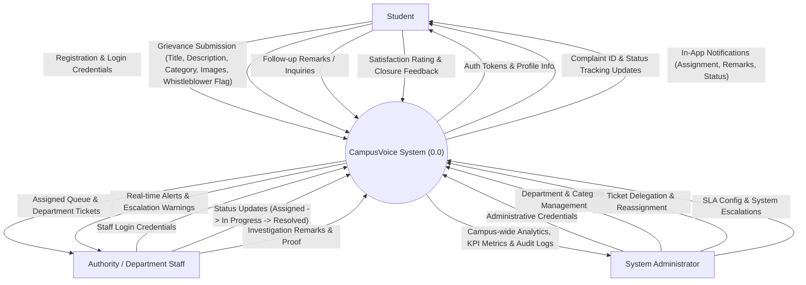
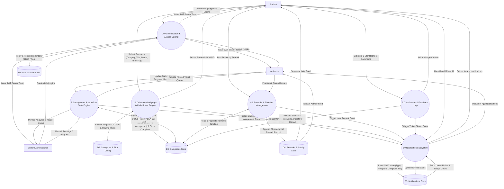

# CampusVoice Data Flow Diagrams (DFD)

This document details the **Level 0 (Context Level)** and **Level 1 (Detailed)** Data Flow Diagrams for the **CampusVoice Grievance Redressal and Campus Issue Reporting System**.

---

## 1. Level 0: Context Analysis Diagram

The Level 0 Context Diagram abstracts the entire CampusVoice platform as a single centralized process, showing interactions with the primary external entities: **Students**, **Department Authorities**, and **System Administrators**.

---

## 2. Level 1: Detailed Functional Data Flow Diagram

The Level 1 DFD decomposes the system into core operational sub-processes:
1. **1.0 Authentication & Identity Management**
2. **2.0 Grievance Lodging & Whistleblower Engine**
3. **3.0 Assignment, SLA Tracking & Authority Workflow**
4. **4.0 Communication & Remarks Timeline**
5. **5.0 Resolution Verification & Feedback Loop**
6. **6.0 Notification Subsystem**

---

## 3. Data Dictionary for Core Flows

| Data Flow Item | Source | Destination | Content Description |
| :--- | :--- | :--- | :--- |
| **Grievance Payload** | Student | Process 2.0 | `title`, `description`, `category_id`, `location`, `priority`, `isAnonymous`, `images[]` |
| **Whistleblower Scrubbed Ticket** | Process 2.0 | Data Store D3 | Stored with `isAnonymous: true`; creator info masked as "Anonymous Student" upon query |
| **Status Transition** | Authority / Admin | Process 3.0 | `status` (`Assigned`, `In Progress`, `Resolved`), `remarks`, timestamp |
| **Remark Item** | Student / Authority | Process 4.0 | `complaintId`, `text`, `user` (id, name, role), `createdAt` |
| **Resolution Feedback** | Student | Process 5.0 | `rating` (1–5 integer), `comments` (optional text), transitions ticket status to `Closed` |
| **Notification Payload** | Process 6.0 | Student / Authority | `recipient`, `title`, `message`, `type` (`ASSIGNMENT`, `STATUS_CHANGE`, `REMARK`, `FEEDBACK`), `relatedComplaint` |
