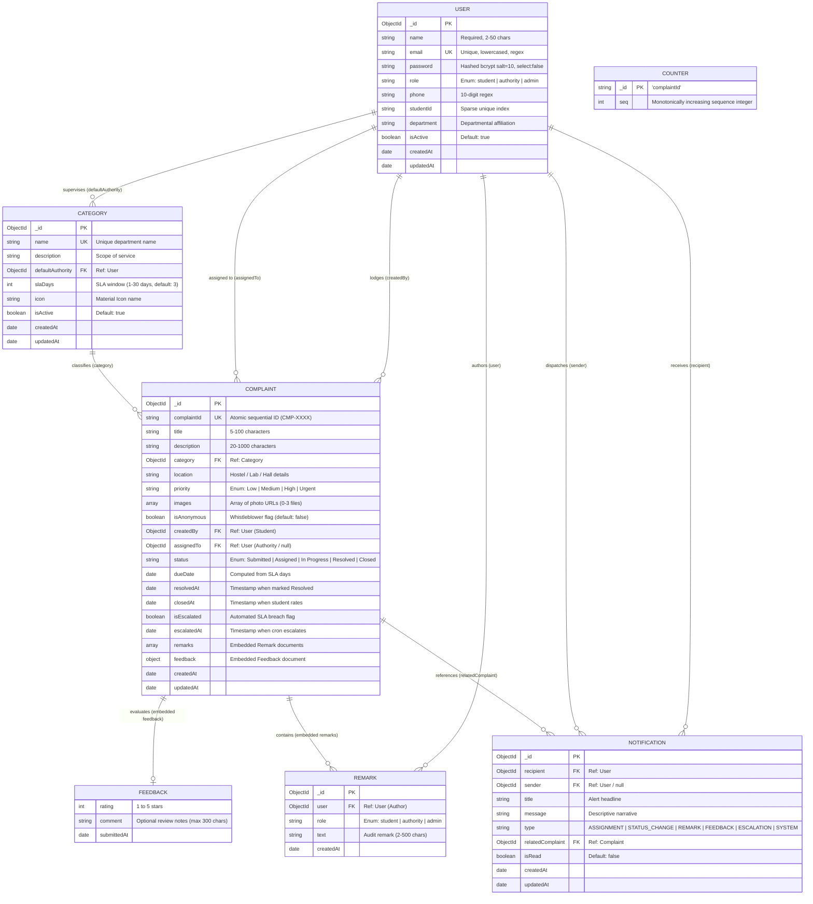

# Entity-Relationship (ER) Specification & Database Schema
## CampusVoice - College Complaint Management System

**Document Version:** 1.0  
**Phase:** 2 - Backend REST API & Database Engine (Day 6 Deliverable)  
**Database Engine:** MongoDB 7.0 (NoSQL Document Store with Schema Validation & Relational References)  

---

## 1. High-Level Entity-Relationship Model

---

## 2. Collection Specifications & Data Dictionaries

### 2.1 `users` Collection
Primary repository for all human actors in the institution.

| Attribute | BSON Type | Constraints & Defaults | Description |
|---|---|---|---|
| `_id` | `ObjectId` | Auto-generated PK | MongoDB internal document identifier. |
| `name` | `String` | Required, Min: 2, Max: 50 | Full legal name of student, technician, or administrator. |
| `email` | `String` | Required, Unique, Lowercase | Institutional `@college.edu` email address. |
| `password` | `String` | Required, Min: 6, `select: false` | 60-character bcrypt hash salted with 10 rounds. |
| `role` | `String` | Enum: `student`, `authority`, `admin` | Role-Based Access Control tier. Default: `student`. |
| `phone` | `String` | Regex: `^[0-9]{10}$` | 10-digit cellular contact for emergency verification. |
| `studentId` | `String` | Trimmed, Sparse Unique Index | Institutional enrollment number (e.g., `CS2023045`). |
| `department` | `String` | Trimmed | Academic department or administrative service division. |
| `isActive` | `Boolean` | Default: `true` | Allows instant account deactivation without cascading deletes. |
| `createdAt` | `Date` | Timestamp | Record creation timestamp. |
| `updatedAt` | `Date` | Timestamp | Record last modification timestamp. |

* **Indexes:**
  - `email`: `{ email: 1 }` (Unique)
  - `role`: `{ role: 1 }`
  - `studentId`: `{ studentId: 1 }` (Sparse, Unique)

---

### 2.2 `categories` Collection
Institutional departments and functional problem domains governing auto-routing and SLA commitments.

| Attribute | BSON Type | Constraints & Defaults | Description |
|---|---|---|---|
| `_id` | `ObjectId` | Auto-generated PK | Category identifier. |
| `name` | `String` | Required, Unique, Max: 50 | Category name (e.g., "Hostel Maintenance"). |
| `description` | `String` | Max: 200 | Informational guidelines displayed in lodging form. |
| `defaultAuthority` | `ObjectId` | Ref: `User`, Default: `null` | Pre-assigned staff member for automated ticket routing. |
| `slaDays` | `Number` | Required, Min: 1, Max: 30, Default: 3 | Resolution turnaround deadline in calendar days. |
| `icon` | `String` | Default: `'help_outline'` | Material Icons identifier for mobile presentation. |
| `isActive` | `Boolean` | Default: `true` | Administrative toggle to archive obsolete categories. |

* **Indexes:**
  - `name`: `{ name: 1 }` (Unique)
  - `isActive`: `{ isActive: 1 }`

---

### 2.3 `complaints` Collection
Central operational document tracking grievance lifecycle, audit timeline, photo evidence, and student ratings.

| Attribute | BSON Type | Constraints & Defaults | Description |
|---|---|---|---|
| `_id` | `ObjectId` | Auto-generated PK | Internal database document identifier. |
| `complaintId` | `String` | Required, Unique Index | Human-readable sequential ID (`CMP-0001`, `CMP-0042`). |
| `title` | `String` | Required, Min: 5, Max: 100 | Concise defect summary. |
| `description` | `String` | Required, Min: 20, Max: 1000 | Detailed narrative of the defect or grievance. |
| `category` | `ObjectId` | Ref: `Category`, Required | Foreign key link to departmental category. |
| `location` | `String` | Required, Max: 100 | Physical location on campus (room, block, lab). |
| `priority` | `String` | Enum: `Low`, `Medium`, `High`, `Urgent` | Urgency level. Default: `Medium`. |
| `images` | `Array<String>` | Max: 3 items | HTTP URLs pointing to media stored in container/cloud. |
| `isAnonymous` | `Boolean` | Default: `false` | Whistleblower privacy flag. |
| `createdBy` | `ObjectId` | Ref: `User`, Required | Foreign key link to student grievant. |
| `assignedTo` | `ObjectId` | Ref: `User`, Default: `null` | Foreign key link to assigned authority technician. |
| `status` | `String` | Enum: `Submitted`, `Assigned`, `In Progress`, `Resolved`, `Closed` | Current operational state in the FSM. |
| `dueDate` | `Date` | Default: `null` | SLA target timestamp: `createdAt + (slaDays * 86400000)`. |
| `resolvedAt` | `Date` | Default: `null` | Timestamp when authority transitions to `Resolved`. |
| `closedAt` | `Date` | Default: `null` | Timestamp when student verifies and submits feedback. |
| `isEscalated` | `Boolean` | Default: `false` | SLA breach flag tripped by daily cron daemon. |
| `escalatedAt` | `Date` | Default: `null` | Timestamp when SLA breach was flagged. |
| `remarks` | `Array<Object>` | Embedded Subdocument Array | Chronological audit trail of notes from all participants. |
| `feedback` | `Object` | Embedded Subdocument, Default: `null` | Student quality evaluation (1–5 rating & comment). |

* **Compound Indexes:**
  - `{ complaintId: 1 }` (Unique)
  - `{ status: 1 }`
  - `{ category: 1 }`
  - `{ createdBy: 1, status: 1 }`
  - `{ assignedTo: 1, status: 1 }`
  - `{ status: 1, dueDate: 1, isEscalated: 1 }` (Cron daemon index)
  - `{ createdAt: -1 }`

---

### 2.4 `notifications` Collection
In-app notification messages dispatched by system lifecycle hooks.

| Attribute | BSON Type | Constraints & Defaults | Description |
|---|---|---|---|
| `_id` | `ObjectId` | Auto-generated PK | Notification document identifier. |
| `recipient` | `ObjectId` | Ref: `User`, Required | Intended target user inbox. |
| `sender` | `ObjectId` | Ref: `User`, Default: `null` | Triggering actor or `null` for automated daemon. |
| `title` | `String` | Required | Short headline alert. |
| `message` | `String` | Required | Detailed narrative body. |
| `type` | `String` | Enum: `ASSIGNMENT`, `STATUS_CHANGE`, `REMARK`, `FEEDBACK`, `ESCALATION`, `SYSTEM` | Notification classification. |
| `relatedComplaint` | `ObjectId` | Ref: `Complaint`, Default: `null` | Foreign key linking to affected complaint document. |
| `isRead` | `Boolean` | Default: `false` | Read receipt indicator. |

* **Indexes:**
  - `{ recipient: 1, isRead: 1, createdAt: -1 }` (Compound index optimizing unread queries)

---

### 2.5 `counters` Collection
Monotonically increasing sequence counters using atomic `findByIdAndUpdate` with `$inc`.

| Attribute | BSON Type | Constraints | Description |
|---|---|---|---|
| `_id` | `String` | PK (`"complaintId"`) | Counter identifier key. |
| `seq` | `Number` | Default: `0` | Current sequence count. |
