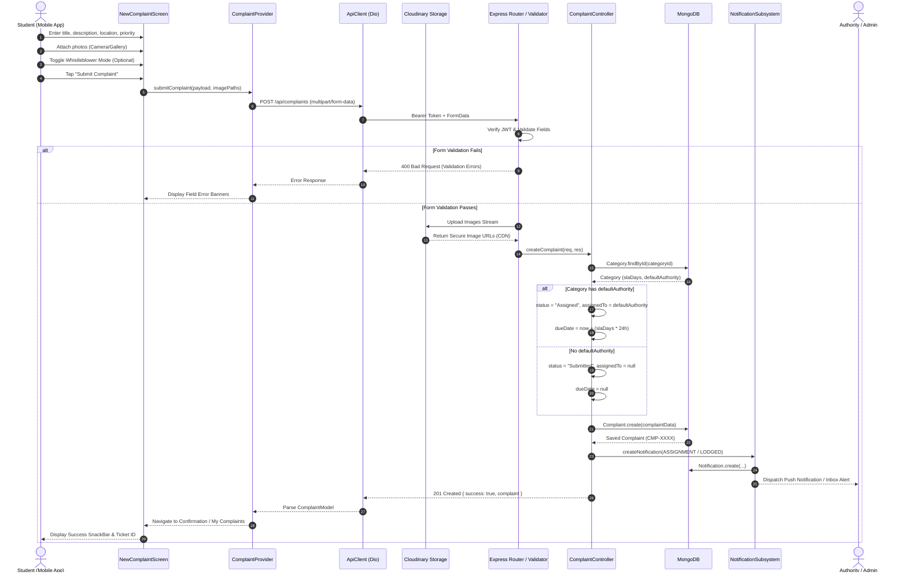
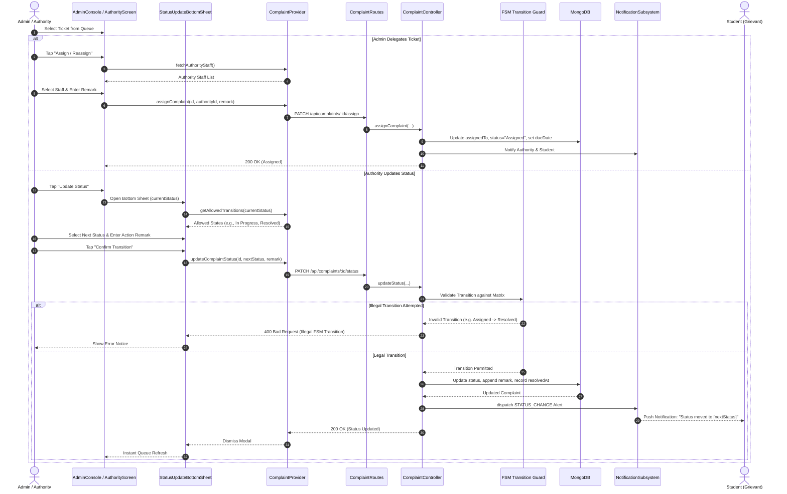
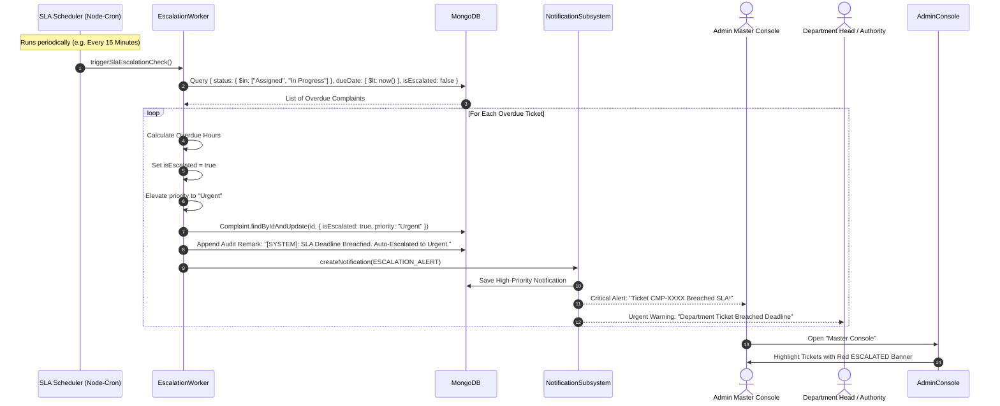
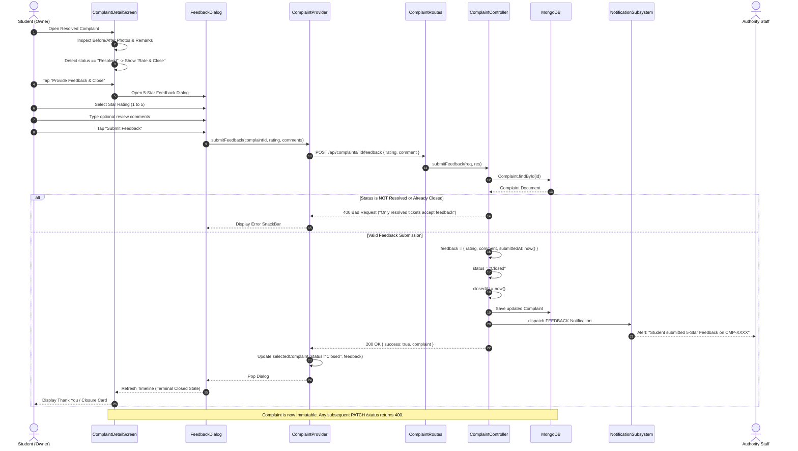

# 🔄 CampusVoice: UML Sequence Diagrams

This document specifies the formal **UML Sequence Diagrams** for the core workflows of the *CampusVoice* grievance and redressal system. It details the chronological exchange of messages between actors, Flutter mobile components, Express.js microservices, database transactions, cloud storage, and notification hooks.

---

## 📑 Table of Contents
1. [Sequence Diagram 1: Grievance Lodging & Auto-Assignment Flow](#1-grievance-lodging--auto-assignment-flow)
2. [Sequence Diagram 2: Status Update, Delegation & Collaborative Remarks Flow](#2-status-update-delegation--collaborative-remarks-flow)
3. [Sequence Diagram 3: SLA Breach Monitoring & Automated Escalation Flow](#3-sla-breach-monitoring--automated-escalation-flow)
4. [Sequence Diagram 4: Student Feedback & Terminal Closure Flow](#4-student-feedback--terminal-closure-flow)

---

## 1. Grievance Lodging & Auto-Assignment Flow

This sequence illustrates a student filing a complaint with photo evidence, selective anonymity, automated SLA calculation, Cloudinary image upload, and intelligent routing based on Category default authority.

---

## 2. Status Update, Delegation & Collaborative Remarks Flow

This sequence details administrative delegation and authority lifecycle execution (`Assigned` $\rightarrow$ `In Progress` $\rightarrow$ `Resolved`), FSM transition validation, and threaded remarks.

---

## 3. SLA Breach Monitoring & Automated Escalation Flow

This sequence documents the background automated SLA watchdog evaluating pending grievances against departmental service deadlines and escalating priority upon breach.

---

## 4. Student Feedback & Terminal Closure Flow

This sequence illustrates the satisfaction feedback loop where a student reviews resolution evidence, rates the experience (1–5 stars), leaves comments, and permanently locks the ticket in the `Closed` terminal state.

---

## 5. Architectural Invariants Verified
1. **Zero Data Leakage:** Whistleblower PII is scrubbed before response serialization across all paths unless requested by the author student or authorized admin.
2. **Finite State Machine Strictness:** Transitions follow the unidirectional graph:
   $$\text{Submitted} \longrightarrow \text{Assigned} \longrightarrow \text{In Progress} \longrightarrow \text{Resolved} \longrightarrow \text{Closed}$$
3. **Audit Trail Completeness:** Every transition, delegation, remark, and escalation appends an immutable entry to `statusHistory` and `remarks`.
