# UML Use Case Specification & Behavioral Model
## CampusVoice - College Complaint Management System

**Document Version:** 1.0  
**Phase:** 1 - Inception, Environment Setup & Domain Modeling (Day 2 Deliverable)  
**Standard:** Unified Modeling Language (UML) 2.5 Specification  

---

## 1. System Scope & Boundary

The **CampusVoice** platform provides a centralized, transparent, and auditable grievance management lifecycle for collegiate institutions. The system boundary encompasses the mobile client, the backend REST services, the persistent database, media storage, and automated scheduled maintenance daemons.

```mermaid
flowchart TB
    subgraph CampusVoice_System ["CampusVoice Grievance Management System Boundary"]
        UC1(["UC-01: User Authentication & Profile"])
        UC2(["UC-02: Lodge Complaint / Grievance"])
        UC3(["UC-03: Attach Proof Media"])
        UC4(["UC-04: Enable Whistleblower Privacy Mask"])
        UC5(["UC-05: Track Complaint Lifecycle & Timeline"])
        UC6(["UC-06: Add Progress Remark"])
        UC7(["UC-07: Provide Feedback & Star Rating"])
        UC8(["UC-08: Close Resolved Complaint"])
        UC9(["UC-09: View Assigned Workload Queue"])
        UC10(["UC-10: Update Complaint Status (FSM)"])
        UC11(["UC-11: Admin Master Complaint Console"])
        UC12(["UC-12: Delegate / Reassign Authority"])
        UC13(["UC-13: Manage Departments & Categories"])
        UC14(["UC-14: Manage User Roles & Access"])
        UC15(["UC-15: View Executive Analytics Dashboard"])
        UC16(["UC-16: Monitor SLA & Trigger Auto-Escalation"])
        UC17(["UC-17: Dispatch In-App & Audit Notifications"])
    end

    %% External Actors
    Student["👤 Student<br/>(Grievant / Whistleblower)"]
    Authority["👷 Authority<br/>(Technician / Warden / HOD)"]
    Admin["👔 Super Admin<br/>(College Dean / Director)"]
    CronDaemon["⏰ Cron Daemon<br/>(Automated SLA Engine)"]

    %% Student Relationships
    Student --> UC1
    Student --> UC2
    Student --> UC5
    Student --> UC6
    Student --> UC7

    %% Authority Relationships
    Authority --> UC1
    Authority --> UC9
    Authority --> UC10
    Authority --> UC6

    %% Admin Relationships
    Admin --> UC1
    Admin --> UC11
    Admin --> UC12
    Admin --> UC13
    Admin --> UC14
    Admin --> UC15

    %% Cron Daemon Relationships
    CronDaemon --> UC16

    %% Internal Use Case Inclusions and Extensions
    UC2 -.->|"<<include>>"| UC3
    UC4 -.->|"<<extend>>"| UC2
    UC7 -.->|"<<include>>"| UC8
    UC10 -.->|"<<include>>"| UC6
    UC10 -.->|"<<include>>"| UC17
    UC12 -.->|"<<include>>"| UC17
    UC16 -.->|"<<include>>"| UC17
    UC2 -.->|"<<include>>"| UC17
```

---

## 2. Actor Characterization Matrix

| Actor | Classification | Technical Description | Operational Role |
|---|---|---|---|
| **Student** | Primary Human Actor | Authenticated student enrolled in the institution. Identified by Roll Number, College Email, and Department. | Discovers campus infrastructure defects, logs tickets, attaches photographic proof, protects identity when exposing sensitive malpractices, and reviews final repairs. |
| **Authority** | Primary Human Actor | Departmental staff member (e.g., Hostel Warden, Mess Manager, Lab Technician, Electrician, Plumber). | Consumes assigned queue, inspects physical site, logs incremental remediation notes, advances ticket states, and certifies repair completion. |
| **Super Admin** | Primary Human Actor | Executive campus administrator (Dean of Student Affairs, Principal, Director). | Governs institution-wide categories, SLA policies, and staff profiles; resolves jurisdictional allocation disputes; reviews macro-level analytical KPIs. |
| **Cron Daemon** | Secondary System Actor | Automated scheduled background process (`node-cron`) executing in headless container space. | Runs continuous/daily cron expressions; checks active complaint due dates against physical clocks; marks SLA breaches as `isEscalated = true`; alerts executive leadership. |

---

## 3. Exhaustive Use Case Specifications

### UC-01: User Authentication & Profile Verification
* **Primary Actor:** Student, Authority, Super Admin
* **Description:** Users register (students only) and authenticate via credentials to receive a cryptographically signed, stateless JSON Web Token (JWT) encapsulating identity and Role-Based Access Control (RBAC) claims.
* **Preconditions:** Network connectivity to the backend API; valid institutional credentials.
* **Trigger:** User opens app and enters email and password.
* **Main Success Scenario:**
  1. User enters institutional email (`@college.edu`) and password.
  2. Client validates input formats against client-side schema.
  3. Server verifies bcrypt salted hash against MongoDB credentials.
  4. Server checks account `isActive` flag.
  5. Server mints 7-day HMAC-SHA256 JWT containing `userId` and `role`.
  6. Client saves JWT in encrypted storage (`FlutterSecureStorage` / Keystore).
  7. Client routes user to respective role dashboard.
* **Exceptions / Postconditions:**
  - 400 Bad Request on invalid credentials.
  - 403 Forbidden on deactivated account.

---

### UC-02: Lodge Complaint / Grievance
* **Primary Actor:** Student
* **Supporting Use Cases:** `<<include>>` UC-03 Attach Proof Media, `<<extend>>` UC-04 Whistleblower Privacy Mask
* **Description:** Student reports a campus defect or administrative grievance by providing title, detailed narrative, physical location, category, and urgency priority.
* **Preconditions:** Student is authenticated.
* **Trigger:** Student taps "Raise Complaint" action button.
* **Main Success Scenario:**
  1. Student fills in Title, Description, Location, and selects Category from active dropdown.
  2. Student selects Priority (Low, Medium, High, Urgent).
  3. Student captures or attaches up to 3 photographic files (UC-03).
  4. Optionally, student toggles Whistleblower Mode (UC-04).
  5. System generates atomic incremental sequential ID (`CMP-0001`).
  6. System checks Category `defaultAuthority` and `slaDays`:
     - If assigned: sets `status = 'Assigned'`, `assignedTo = defaultAuthority`, `dueDate = now + (slaDays * 86400000)`.
     - Else: sets `status = 'Submitted'`.
  7. System saves record and dispatches `UC-17` notification to assigned authority.
* **Postconditions:** Grievance record is persisted with status `Submitted` or `Assigned`.

---

### UC-04: Enable Whistleblower Privacy Mask
* **Primary Actor:** Student
* **Description:** Anonymizes the student's personal identity for sensitive complaints (e.g., ragging, misconduct, harassment) while preserving legitimate ticket authenticity.
* **Trigger:** Student toggles "Submit Anonymously" switch on grievance form.
* **Main Success Scenario:**
  1. Flag `isAnonymous = true` is set on grievance record.
  2. Backend stores original student reference internally for abuse audit logs.
  3. Any subsequent read requests from Authorities or non-super-admin staff sanitize `createdBy` object to `{"name": "Anonymous Student"}` and completely strip phone, email, roll number, and department fields.

---

### UC-05: Track Complaint Lifecycle & Audit Timeline
* **Primary Actor:** Student, Authority, Super Admin
* **Description:** Real-time inspection of a complaint's progression through the Finite State Machine (FSM), including chronological audit trail, location, SLA countdown, and resolution notes.
* **Preconditions:** Complaint exists and requester is authorized.
* **Main Success Scenario:**
  1. User selects a complaint from their dashboard list.
  2. App displays full metadata: sequential ID, status badge, priority badge, SLA due date remaining, photo gallery carousel.
  3. App renders chronological timeline of all transitions and remarks.

---

### UC-07: Provide Feedback & Star Rating
* **Primary Actor:** Student
* **Supporting Use Case:** `<<include>>` UC-08 Close Resolved Complaint
* **Description:** The student inspects physical repairs, provides a 1–5 star rating with narrative remarks, and formally closes the grievance ticket.
* **Preconditions:** Complaint status is strictly in `Resolved` state. Requester is the original creator.
* **Trigger:** Student taps "Verify & Rate Resolution" button.
* **Main Success Scenario:**
  1. Interactive modal presents 1–5 star rating bar and review input.
  2. Student submits rating and optional feedback comments.
  3. System records `feedback: { rating, comments, createdAt: now }`.
  4. System transitions status to terminal state `Closed` (UC-08) and timestamps `closedAt`.
  5. Notification is dispatched to authority informing them of closure and satisfaction score.

---

### UC-09 & UC-10: Authority Workload & Status Transition FSM
* **Primary Actor:** Authority
* **Supporting Use Case:** `<<include>>` UC-06 Add Progress Remark
* **Description:** Authority reviews tickets routed to their department and progresses them through valid operational states while providing mandatory accountability remarks.
* **FSM Rules Enforced:**
  - `Submitted` $\rightarrow$ `Assigned`
  - `Assigned` $\rightarrow$ `In Progress`
  - `In Progress` $\rightarrow$ `Resolved` (Requires mandatory repair remark and verification)
* **Preconditions:** Authority owns the assigned ticket.
* **Main Success Scenario:**
  1. Authority views work queue filtered by priority and due date.
  2. Authority selects ticket and taps "Update Status".
  3. Action sheet presents only legally allowable state transitions according to the FSM matrix.
  4. Authority enters mandatory action remark (e.g., "Technician replaced capacitor on 2nd floor air compressor").
  5. System validates transition, records remark, updates state, and sets `resolvedAt` timestamp if transitioning to `Resolved`.

---

### UC-11 & UC-12: Admin Master Console & Ticket Delegation
* **Primary Actor:** Super Admin
* **Description:** Executive oversight interface allowing search across all campus grievances, filtering by department or escalation status, and manual delegation/reassignment of tickets.
* **Main Success Scenario:**
  1. Admin opens Master Complaint Console.
  2. Admin filters for unassigned or escalated tickets.
  3. Admin opens Reassignment Dialog, selects target authority technician, and clicks "Confirm Transfer".
  4. System updates `assignedTo`, computes new SLA due date, records audit remark, and notifies both prior and new authorities.

---

### UC-13 & UC-14: Administrative Master Data Governance
* **Primary Actor:** Super Admin
* **Description:** CRUD operations for campus categories (e.g., "Electrical", "Sanitation", "Network Services", "Hostel", "Mess"), configuration of default authorities, SLA deadlines in calendar days, and staff account activation/deactivation.

---

### UC-15: View Executive Analytics Dashboard
* **Primary Actor:** Super Admin
* **Description:** Real-time business intelligence visualizations:
  - Aggregate counters (Total, Open, Resolved, Escalated).
  - Category distribution (Pie chart).
  - Status distribution breakdown (Bar chart).
  - 6-month grievance volume trajectory (Line chart).
  - Mean Time to Resolution (MTTR) performance metrics.

---

### UC-16: Automated SLA Breach Monitoring & Auto-Escalation
* **Primary Actor:** Cron Daemon
* **Trigger:** Scheduled cron timer (`0 0 * * *` daily at midnight, or manual viva trigger).
* **Main Success Scenario:**
  1. Daemon awakens and queries database:
     `status NOT IN ('Resolved', 'Closed') AND dueDate < now AND isEscalated == false`.
  2. For every matching overdue complaint:
     - Sets `isEscalated = true`.
     - Records `escalatedAt = now`.
     - Appends automated system audit remark: *"System Alert: SLA breached by [X] days. Escalated to Executive Administration."*
     - Generates high-priority urgent notification to all Super Admins.
  3. Daemon logs execution stats to stdout and sleeps until next interval.
