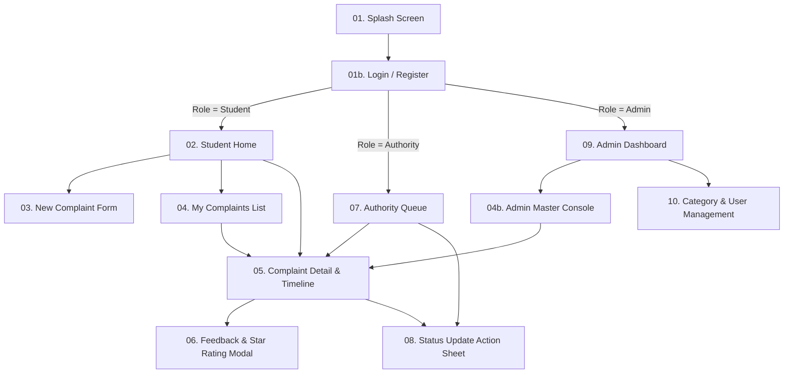

# High-Fidelity UI Wireframe Specification & Screen Blueprints
## CampusVoice - College Complaint Management System

**Document Version:** 1.0  
**Phase:** 1 - Inception, Environment Setup & Domain Modeling (Day 2 Deliverable)  
**Design System:** Material Design 3 (Material You)  
**Target Viewport:** 393 × 852 pt (Mobile Portrait - Android / iOS Standard)  
**Color Tokens:**
- Primary: `#1E3A8A` (Deep Indigo / Academic Blue)
- Primary Container: `#DBEAFE` (Soft Sky)
- Secondary: `#0D9488` (Teal Accent)
- Surface / Background: `#F8FAFC` (Cool Off-White)
- Surface Card: `#FFFFFF` (Pure White)
- Error / Escalation: `#DC2626` (Crimson Red)
- Warning / Pending: `#F59E0B` (Amber Orange)
- Success / Resolved: `#16A34A` (Emerald Green)
- Neutral Gray / Text: `#1E293B` (Slate Navy) / `#64748B` (Muted Slate)

---

## Screen Navigation Architecture Map



---

## Screen 01: Splash & Authentication (Login / Register)

### 1.1 Wireframe Layout
```
+---------------------------------------------------+
|  [ 12:00 ]                         5G [====] 100% |
+---------------------------------------------------+
|                                                   |
|                    [ LOGO ]                       |
|                  CAMPUS VOICE                     |
|           College Grievance Portal                |
|                                                   |
|      +-------------------------------------+      |
|      |        LOGIN    |    REGISTER       |      |
|      +-------------------------------------+      |
|                                                   |
|      College Email Address                        |
|      +-------------------------------------+      |
|      | student@college.edu            [@]  |      |
|      +-------------------------------------+      |
|                                                   |
|      Password                                     |
|      +-------------------------------------+      |
|      | ****************               [👁]  |      |
|      +-------------------------------------+      |
|                                                   |
|      [ ] Remember Me        Forgot Password?      |
|                                                   |
|      +-------------------------------------+      |
|      |               SIGN IN               |      |
|      +-------------------------------------+      |
|                                                   |
|      ------- OR CONTINUE AS GUEST / DEMO -------- |
|                                                   |
|      [ Student Demo ]  [ Staff ]  [ Admin ]       |
|                                                   |
|      By signing in, you agree to the Campus       |
|      Code of Conduct & Whistleblower Policy       |
+---------------------------------------------------+
```

### 1.2 Component Specifications
* **Brand Header:** Center-aligned SVG crest with 24sp typography (`Inter SemiBold`), subtitle 14sp (`Inter Regular`).
* **Role Switcher Tab:** Segmented pill container (`height: 48dp`, active tab: `#1E3A8A` background with white text).
* **Input Fields:** Material 3 `OutlinedTextField` with floating label, prefix icon, and right-aligned action icon (e.g. visibility toggle for passwords).
* **Validation Rules:**
  - Email: Must match `/^[a-zA-Z0-9._%+-]+@college\.edu$/` or standard email pattern.
  - Password: Minimum 8 characters.
* **Error Banner:** Inline animated banner (`#FEE2E2` container with `#DC2626` text) displayed if credentials fail.

---

## Screen 02: Student Home & Grievance Dashboard

### 2.1 Wireframe Layout
```
+---------------------------------------------------+
|  [ 12:00 ]                         5G [====] 100% |
+---------------------------------------------------+
|  [Avatar] Hi, Alex Johnson               [🔔 (2)] |
|  Roll: CS-2023-042 • Hostel Block B               |
+---------------------------------------------------+
|                                                   |
|  +=============================================+  |
|  |  HAVE AN ISSUE ON CAMPUS?                   |  |
|  |  Report broken facilities, mess hygiene, or |  |
|  |  academic grievances with photo proof.      |  |
|  |                                             |  |
|  |  [ + RAISE NEW COMPLAINT ]                  |  |
|  +=============================================+  |
|                                                   |
|  ACTIVE GRIEVANCE METRICS                         |
|  +------------+ +------------+ +------------+     |
|  |     03     | |     01     | |     08     |     |
|  | In Progress| | Escalated  | |  Resolved  |     |
|  +------------+ +------------+ +------------+     |
|                                                   |
|  RECENT GRIEVANCES                   [ View All ] |
|                                                   |
|  +---------------------------------------------+  |
|  | CMP-0042 • Hostels              [IN PROGRESS]| |
|  | Water leakage in 2nd Floor Washroom         |  |
|  | Assigned to: Hostel Warden • Due in 18 hrs  |  |
|  +---------------------------------------------+  |
|  | CMP-0038 • Electrical               [CLOSED]|  |
|  | Tube light replacement in Lab 304           |  |
|  | Rated: ★★★★★ (Resolved in 1.2 days)         |  |
|  +---------------------------------------------+  |
|                                                   |
+---------------------------------------------------+
|  [🏠 Home]    [📋 My Tickets]    [🔔 Alerts]   [👤] |
+---------------------------------------------------+
```

### 2.2 Component Specifications
* **User Profile Header:** Dynamic greeting with greeting icon, user department/hostel subtitle, and notification badge with unread count.
* **Hero Action Card:** High-contrast gradient card (`#1E3A8A` to `#1E40AF`) with prominent `ElevatedButton` ("+ Raise New Complaint").
* **Grievance Metrics Cards:** 3 horizontal stat widgets showing active operational counts with semantic color accents.
* **Recent Grievance Cards:** Tappable summary cards displaying unique sequential ticket ID, category tag, title, status chip, and relative SLA deadline.
* **Bottom Navigation Bar:** 4 destinations: Home, My Tickets, Notifications, Profile.

---

## Screen 03: New Complaint Lodging Form

### 3.1 Wireframe Layout
```
+---------------------------------------------------+
|  [<-] Back            Lodge Complaint             |
+---------------------------------------------------+
|                                                   |
|  Complaint Title *                                |
|  +---------------------------------------------+  |
|  | e.g. Water cooler leaking on 1st floor      |  |
|  +---------------------------------------------+  |
|                                                   |
|  Department / Category *                          |
|  +---------------------------------------------+  |
|  | [Icon] Hostel & Accommodation          [ v ]|  |
|  +---------------------------------------------+  |
|  * SLA: 2 Business Days • Auto-routed to Warden   |
|                                                   |
|  Exact Location / Room No. *                      |
|  +---------------------------------------------+  |
|  | Block B, 2nd Floor Corridor, near Room 204  |  |
|  +---------------------------------------------+  |
|                                                   |
|  Priority Level *                                 |
|  +---------------------------------------------+  |
|  | ( ) Low   ( ) Medium   (*) High   ( ) Urgent|  |
|  +---------------------------------------------+  |
|                                                   |
|  Detailed Description *                           |
|  +---------------------------------------------+  |
|  | Water has been dripping continuously since  |  |
|  | morning, causing a slipping hazard...       |  |
|  |                                  (84/500)   |  |
|  +---------------------------------------------+  |
|                                                   |
|  Photographic Evidence (Max 3)                    |
|  +-------+ +-------+ +-------+                    |
|  | [IMG] | | [IMG] | |  [+]  |                    |
|  |  (x)  | |  (x)  | | Add   |                    |
|  +-------+ +-------+ +-------+                    |
|                                                   |
|  +---------------------------------------------+  |
|  | [🛡️] WHISTLEBLOWER MODE                     |  |
|  | Submit Anonymously                   [ ON ] |  |
|  | Your name, email & phone will be stripped  |  |
|  | from authority and staff records.           |  |
|  +---------------------------------------------+  |
|                                                   |
|  +---------------------------------------------+  |
|  |             SUBMIT GRIEVANCE                |  |
|  +---------------------------------------------+  |
|                                                   |
+---------------------------------------------------+
```

### 3.2 Component Specifications
* **Category Dropdown:** Auto-populated from `GET /api/categories`, displaying SLA commitment note dynamically when a category is picked.
* **Priority Segmented Selector:** Radio/Segmented button with color-coded chips (Urgent = Red, High = Amber, Medium = Blue, Low = Slate).
* **Media Attachment Grid:** Horizontal thumbnail preview container with delete badges (`x`) and Camera/Gallery bottom-sheet trigger (`+ Add`).
* **Whistleblower Toggle Card:** Amber background card (`#FEF3C7`) with Shield icon and explanation text explaining cryptographic identity masking.
* **Submit CTA Button:** Sticky or bottom-pinned button with circular progress indicator on network upload.

---

## Screen 04: My Complaints List & Filter Chips

### 4.1 Wireframe Layout
```
+---------------------------------------------------+
|  [ 12:00 ]                         5G [====] 100% |
+---------------------------------------------------+
|  My Grievances                         [Search 🔍]|
|                                                   |
|  [🔍 Search by ID or keyword...                 ] |
|                                                   |
|  FILTER BY STATUS:                                |
|  +------+ +----------+ +-----------+ +----------+ |
|  |[All] | |Submitted | |In Progress| |[Resolved]| |
|  +------+ +----------+ +-----------+ +----------+ |
|                                                   |
|  Showing 4 complaints                             |
|                                                   |
|  +---------------------------------------------+  |
|  | CMP-0042 • Hostels              [IN PROGRESS]| |
|  | Water leakage in 2nd Floor Washroom         |  |
|  | Lodged: 28 Oct • Due: Today, 6:00 PM (⚠️)   |  |
|  | Assigned to: Dr. M. Sharma (Warden)         |  |
|  +---------------------------------------------+  |
|                                                   |
|  +---------------------------------------------+  |
|  | CMP-0040 • Sanitation               [RESOLVED]||
|  | Waste bins overflowing outside Canteen      |  |
|  | Lodged: 26 Oct • Resolved: 27 Oct           |  |
|  | [ ★ RATE RESOLUTION TO CLOSE TICKET ★ ]     |  |
|  +---------------------------------------------+  |
|                                                   |
|  +---------------------------------------------+  |
|  | CMP-0035 • IT & Wi-Fi               [CLOSED]|  |
|  | No internet connectivity in CS Lab 2        |  |
|  | Resolved & Verified • Rating: ★★★★★         |  |
|  +---------------------------------------------+  |
|                                                   |
+---------------------------------------------------+
|  [🏠 Home]    [📋 My Tickets]    [🔔 Alerts]   [👤] |
+---------------------------------------------------+
```

### 4.2 Component Specifications
* **Filter Chips Row:** Horizontally scrollable single-select filter chips (`All`, `Submitted`, `Assigned`, `In Progress`, `Resolved`, `Closed`).
* **Actionable Resolution Card:** If status is `Resolved`, card renders an eye-catching amber/green call-to-action button prompting verification.
* **SLA Urgency Badges:**
  - On schedule: Grey/Slate relative time ("Due in 2 days").
  - Due soon (< 12 hrs): Amber clock badge ("Due today").
  - Overdue: Crimson pulse badge ("OVERDUE / ESCALATED").
* **Empty State:** Illustrated vector graphic with *"No grievances found in this category"* and a button to *"Raise a Complaint"*.

---

## Screen 05: Complaint Detail & Audit Timeline

### 5.1 Wireframe Layout
```
+---------------------------------------------------+
|  [<-] Back         CMP-0042            [Share 📤] |
+---------------------------------------------------+
|                                                   |
|  STATUS & SLA OVERVIEW                            |
|  +---------------------------------------------+  |
|  | Status: [ IN PROGRESS ]    Priority: [HIGH] |  |
|  | Category: Hostel & Living                   |  |
|  | SLA Target: 48 Hours                        |  |
|  | Time Remaining: 14 hrs 32 mins (On Track)   |  |
|  +---------------------------------------------+  |
|                                                   |
|  Water leakage in 2nd Floor Washroom              |
|  Location: Block B, 2nd Floor, Room 204           |
|                                                   |
|  Description:                                     |
|  Water pipe under sink has ruptured. Floor is     |
|  completely wet and slipping hazard for students. |
|                                                   |
|  ATTACHED EVIDENCE (2 PHOTOS)                     |
|  +-------------------+  +-------------------+     |
|  | [Photo 1 Preview] |  | [Photo 2 Preview] |     |
|  +-------------------+  +-------------------+     |
|                                                   |
|  LIFECYCLE AUDIT TIMELINE                         |
|  o [28 Oct, 09:15 AM] • Ticket Submitted          |
|  | By Alex Johnson (Roll: CS-2023-042)            |
|  |                                                |
|  o [28 Oct, 09:16 AM] • Auto-Assigned             |
|  | Assigned to Hostel Warden (SLA: 2 Days)        |
|  |                                                |
|  o [28 Oct, 02:30 PM] • Status -> IN PROGRESS     |
|  | Remark: "Plumber visited site. Ordered         |
|  | replacement valve from store."                 |
|  | By: Dr. M. Sharma (Warden)                     |
|                                                   |
|  +---------------------------------------------+  |
|  | [💬] Add a follow-up remark...         [Send]| |
|  +---------------------------------------------+  |
|                                                   |
+---------------------------------------------------+
```

### 5.2 Component Specifications
* **Interactive Image Carousel:** Tapping thumbnails triggers full-screen dialog with pan/zoom (`InteractiveViewer`).
* **Audit Timeline:** Vertical stepper with colored status nodes (`Submitted` -> `Assigned` -> `In Progress` -> `Resolved` -> `Closed`).
* **Anonymous Mask Check:** If `isAnonymous == true`, author field displays *"Reported Anonymously"* with a privacy shield badge.
* **Remark Input Bar:** Floating bottom input field for real-time threaded collaboration between student and assigned authority.

---

## Screen 06: Feedback & Star Rating Modal

### 6.1 Wireframe Layout
```
+---------------------------------------------------+
|                                                   |
|       ====================================        |
|       |     VERIFY & CLOSE GRIEVANCE     |        |
|       |           CMP-0040               |        |
|       ====================================        |
|                                                   |
|       The authority marked this issue as:         |
|                 [ RESOLVED ]                      |
|       "Sanitation staff cleared all bins and      |
|        disinfected the cafeteria walkway."        |
|                                                   |
|       Are you satisfied with the resolution?      |
|                                                   |
|               ★   ★   ★   ★   ☆                   |
|                   (4.0 / 5.0)                     |
|                   Very Good                       |
|                                                   |
|       Additional Comments (Optional):             |
|       +------------------------------------+      |
|       | Cleared quickly, thank you! Please |      |
|       | ensure bins have lids next time.   |      |
|       +------------------------------------+      |
|                                                   |
|       +------------------------------------+      |
|       |       ACCEPT & CLOSE TICKET        |      |
|       +------------------------------------+      |
|                                                   |
|       [ Not Resolved? Raise Concern ]             |
|                                                   |
+---------------------------------------------------+
```

### 6.2 Component Specifications
* **Modal Trigger:** Displays automatically as a modal bottom sheet or dialog when viewing a `Resolved` ticket.
* **Rating Selector:** Custom 5-star touch-sensitive row with real-time semantic descriptor (1 = Very Poor, 3 = Average, 5 = Excellent).
* **Terminal Closure:** Tapping "ACCEPT & CLOSE TICKET" dispatches `POST /api/complaints/:id/feedback`, changing status to `Closed` and recording `closedAt`.

---

## Screen 07: Authority Queue & Task List

### 7.1 Wireframe Layout
```
+---------------------------------------------------+
|  [ 12:00 ]                         5G [====] 100% |
+---------------------------------------------------+
|  Staff Portal: Dr. M. Sharma (Warden)    [Logout] |
|  Department: Hostel & Facilities                  |
+---------------------------------------------------+
|                                                   |
|  TASK WORKLOAD SUMMARY                            |
|  +-------------+ +-------------+ +--------------+ |
|  |     12      | |     05      | |      02      | |
|  | Assigned    | | In Progress | | Overdue (⚠️) | |
|  +-------------+ +-------------+ +--------------+ |
|                                                   |
|  ASSIGNED GRIEVANCE QUEUE             [Sort: SLA] |
|                                                   |
|  +---------------------------------------------+  |
|  | [⚠️ OVERDUE] • CMP-0031          [URGENT]   |  |
|  | Broken main door lock in Room 102           |  |
|  | Breached by: 1.5 Days • Escalated to Dean   |  |
|  | [ UPDATE STATUS ]       [ VIEW DETAILS ]    |  |
|  +---------------------------------------------+  |
|                                                   |
|  +---------------------------------------------+  |
|  | CMP-0042 • Due in 14 hrs          [HIGH]     |  |
|  | Water leakage in 2nd Floor Washroom         |  |
|  | Status: IN PROGRESS • Student: Alex Johnson |  |
|  | [ UPDATE STATUS ]       [ VIEW DETAILS ]    |  |
|  +---------------------------------------------+  |
|                                                   |
|  +---------------------------------------------+  |
|  | CMP-0044 • Due in 2 days        [MEDIUM]    |  |
|  | Ceiling fan regulator burnt out             |  |
|  | Status: ASSIGNED                            |  |
|  | [ START WORK ]          [ VIEW DETAILS ]    |  |
|  +---------------------------------------------+  |
|                                                   |
+---------------------------------------------------+
```

### 7.2 Component Specifications
* **Queue Filtering:** Filter by `Assigned`, `In Progress`, and `Overdue`.
* **Fast-Action Buttons:** Direct buttons on the ticket cards (`Start Work`, `Update Status`) bypassing deep navigation for field technicians.
* **Escalation Indicator:** High-visibility crimson border and banner for tickets where `isEscalated == true`.

---

## Screen 08: Status Update Action Sheet

### 8.1 Wireframe Layout
```
+---------------------------------------------------+
|                                                   |
|  +---------------------------------------------+  |
|  | UPDATE COMPLAINT STATUS                     |  |
|  | CMP-0042: Water leakage in Washroom         |  |
|  | Current Status: [ IN PROGRESS ]             |  |
|  +---------------------------------------------+  |
|                                                   |
|  Select Next Operational State:                   |
|  ( ) Assigned                                     |
|  (*) In Progress                                  |
|  ( ) Resolved (Ready for Student Verification)    |
|                                                   |
|  Mandatory Action Remark *:                       |
|  +---------------------------------------------+  |
|  | Plumber has replaced the 1.5" PVC valve     |  |
|  | and verified zero leakage under pressure.   |  |
|  | Area cleaned and dried.                     |  |
|  +---------------------------------------------+  |
|                                                   |
|  Attach Completion Proof Photo (Optional):        |
|  +-----------+                                    |
|  |  [+] Add  |                                    |
|  | Completion|                                    |
|  +-----------+                                    |
|                                                   |
|  +---------------------------------------------+  |
|  |           SAVE STATUS TRANSITION            |  |
|  +---------------------------------------------+  |
|                                                   |
+---------------------------------------------------+
```

### 8.2 Component Specifications
* **State Transition Validator:** Displays only legal state transitions governed by the PRD Finite State Machine.
* **Mandatory Remark Guard:** Save button remains disabled until at least 10 characters are typed into the action remark field.
* **Resolution Proof:** Option to capture after-fix photo proof before marking `Resolved`.

---

## Screen 09: Admin Executive Analytics Dashboard

### 9.1 Wireframe Layout
```
+---------------------------------------------------+
|  [ 12:00 ]                         5G [====] 100% |
+---------------------------------------------------+
|  Executive Dashboard               [Period: 30D v]|
|  Institution Overview: Dean of Student Affairs    |
+---------------------------------------------------+
|                                                   |
|  KEY PERFORMANCE INDICATORS                       |
|  +------------+ +------------+ +------------+     |
|  |    148     | |   89.2%    | |   1.8 Days |     |
|  | Total Logs | | Resolution | | Mean TTR   |     |
|  +------------+ +------------+ +------------+     |
|  +------------+ +------------+ +------------+     |
|  |     16     | |     04     | |  4.2 / 5.0 |     |
|  | In Progress| | Escalated  | | Avg Rating |     |
|  +------------+ +------------+ +------------+     |
|                                                   |
|  GRIEVANCE BY CATEGORY (DONUT CHART)              |
|         .---.        [■] Hostels (42%)            |
|       /   |   \      [■] Electrical (28%)         |
|      |    O    |     [■] IT & WiFi (18%)          |
|       \       /      [■] Sanitation (12%)         |
|         '---'                                     |
|                                                   |
|  MONTHLY RESOLUTION TREND (BAR / LINE)            |
|     Logs |                                        |
|      50 -|        |█|                             |
|      30 -|  |█|   |█|   |█|                       |
|      10 -|__|█|___|█|___|█|____                   |
|            Aug    Sep   Oct                       |
|                                                   |
|  URGENT ESCALATION ALERTS (4 BREACHES)            |
|  +---------------------------------------------+  |
|  | CMP-0031 • Hostel Door Lock • 38h Overdue   |  |
|  | [ Reassign Authority ]   [ Escalate to HOD ]|  |
|  +---------------------------------------------+  |
|                                                   |
+---------------------------------------------------+
| [📊 Overview] [📋 Master] [📁 Categories] [👥 Users]|
+---------------------------------------------------+
```

### 9.2 Component Specifications
* **Interactive Charts:** Powered by `fl_chart` (Touch-enabled donut tooltips and monthly volume bars).
* **MTTR Metric:** Dynamically calculated Mean Time to Resolution displayed prominently.
* **Breach Action Panel:** Direct reassignment and escalation triggers for executive administration.

---

## Screen 10: Category & User Governance

### 10.1 Wireframe Layout
```
+---------------------------------------------------+
|  [ 12:00 ]                         5G [====] 100% |
+---------------------------------------------------+
|  System Governance                                |
|  +---------------------------------------------+  |
|  |    CATEGORIES (6)    |      USERS (48)      |  |
|  +---------------------------------------------+  |
|                                                   |
|  CAMPUS CATEGORIES & SLA RULES      [ + ADD NEW ] |
|                                                   |
|  +---------------------------------------------+  |
|  | [Icon] Hostel & Living             [ACTIVE] |  |
|  | SLA: 2 Calendar Days • Auto-Assign: Warden  |  |
|  | Total Tickets: 62 • Toggle Status: [ON]    |  |
|  +---------------------------------------------+  |
|                                                   |
|  +---------------------------------------------+  |
|  | [Icon] Electrical & Power          [ACTIVE] |  |
|  | SLA: 1 Calendar Day • Auto-Assign: Tech     |  |
|  | Total Tickets: 41 • Toggle Status: [ON]    |  |
|  +---------------------------------------------+  |
|                                                   |
|  +---------------------------------------------+  |
|  | [Icon] Mess & Food Hygiene         [ACTIVE] |  |
|  | SLA: 1 Calendar Day • Auto-Assign: Manager  |  |
|  | Total Tickets: 25 • Toggle Status: [ON]    |  |
|  +---------------------------------------------+  |
|                                                   |
|  [FAB: + New Category / + New Staff Profile]      |
+---------------------------------------------------+
| [📊 Overview] [📋 Master] [📁 Categories] [👥 Users]|
+---------------------------------------------------+
```

### 10.2 Component Specifications
* **Tab Navigation:** Segmented view toggling between Department Categories and User Accounts.
* **Category Configuration Modal:** Dialog allows setting Category Name, Description, SLA window (in days), and picking default authority staff from a dropdown.
* **User Management Tab:** Lists all staff authorities and students with search, role badges, and an immediate access activation toggle (`isActive: true/false`).
